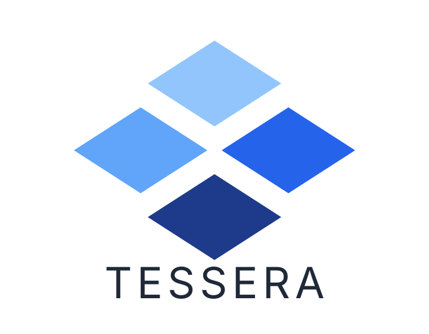

<p align="center">
  <picture>
    <source media="(prefers-color-scheme: dark)" srcset="docs/public/branding/tessera-logo-wordmark-dark.svg">
    <source media="(prefers-color-scheme: light)" srcset="docs/public/branding/tessera-logo-wordmark.svg">
    
  </picture>
</p>

<p align="center">
  <strong>Run multiple agents in the same Git repository.</strong>
</p>

Tessera works on top of your existing Git repository. Instead of replacing Git, it acts as a local coordination layer in `.git/tessera` that lets concurrent AI agents and terminal tabs share one checkout, work on independent branches, and merge edits at the AST level without overwriting files.

## Quick Start

### 1. Install the CLI

**macOS, Linux, and BSD:**

```bash
curl -fsSL https://tessera.getlunaris.dev/install.sh | sh
```

**Windows (PowerShell):**

```powershell
irm https://tessera.getlunaris.dev/install.ps1 | iex
```

### 2. Initialize Your Repository

```bash
tes init
tes env --install
```

`tes init` sets up `.git/tessera` and installs rules for your AI coding editor so agents coordinate automatically. `tes env --install` adds `(tes:<branch>)` to your shell prompt.

### 3. Work Across Branches

```bash
# Terminal 1: switch to feat/pricing and run tests
tes switch feat/pricing
npm test
tes status
tes diff

# Terminal 2: switch to feat/faq and run dev server at the same time
tes switch feat/faq
npm run dev

# Merge both branches into main when done
tes merge feat/pricing feat/faq --into main -m "feat: add pricing and faq"
```

## Documentation

Full documentation is built with **VitePress** in [`docs/`](./docs):

```bash
npm --prefix docs run docs:dev     # Start local documentation site
npm --prefix docs run docs:build   # Build static documentation site
```

- [Why Tessera?](./docs/getting-started/why-tessera.md)
- [Getting Started](./docs/getting-started/index.md)
- [Installation](./docs/getting-started/installation.md)
- [Your First Workflow](./docs/getting-started/first-workflow.md)
- [Configuration](./docs/guides/configuration.md)
- [Editor Support](./docs/guides/ide-extension.md)
- [Agents](./docs/guides/multi-agent-workflow.md)
- [Branches](./docs/guides/branches-and-terminals.md)
- [Sandboxes](./docs/guides/running-tests-and-servers.md)
- [Conflicts](./docs/guides/conflict-resolution.md)
- [CLI Commands](./docs/cli/index.md)
- [Examples](./docs/examples/index.md)

## Contributing

Tessera is organized into three main workspaces:

- [`src/`](./src) - Rust workspace containing the `tes` CLI (`crates/cli`) and core libraries (`crates/core`, `crates/git-backend`, `crates/oplog`, `crates/merge`, `crates/workspace`, `crates/agent`, `crates/mcp`).
- [`extensions/vscode/`](./extensions/vscode) - Extension for VS Code and VS Code-based editors (Antigravity, Cursor, Windsurf, Kiro, VSCodium) providing live branch switching, multi-agent line attribution, 2D Branch Graph, and conflict resolution.
- [`docs/`](./docs) - VitePress documentation site and machine-readable agent bundles (`agents.txt`, `llms.txt`, `llms-full.txt`).

### Building & Testing From Source

```bash
# Build and run the Rust workspace test suite
cargo test --manifest-path src/Cargo.toml --workspace

# Run Clippy lints
cargo clippy --manifest-path src/Cargo.toml --workspace --all-targets

# Build the VS Code extension
npm --prefix extensions/vscode ci
npm --prefix extensions/vscode run compile

# Build the documentation site
npm --prefix docs ci
npm --prefix docs run docs:build
```

### Dogfooding With Tessera

This repository uses Tessera (`tes`) for branch isolation and multi-agent coordination. Always pull the latest `main` before creating a new branch:

```bash
# Initialize local .git/tessera state
tes init

# Sync main before branching off
tes pull origin main
tes switch -c feat/my-change

# Or fetch and switch to an existing remote branch
tes pull origin <branch>
tes switch <branch>

# Inspect session status, diffs, and active agents
tes status
tes diff
tes radar
```

Commit messages follow [Conventional Commits](https://www.conventionalcommits.org/) (`<type>(<scope>): <concise description in imperative mood>`, where `<type>` is one of `feat`, `fix`, `refactor`, `perf`, `test`, `docs`, `ci`, or `chore`).

## License

Released under the [MIT License](./LICENSE).
